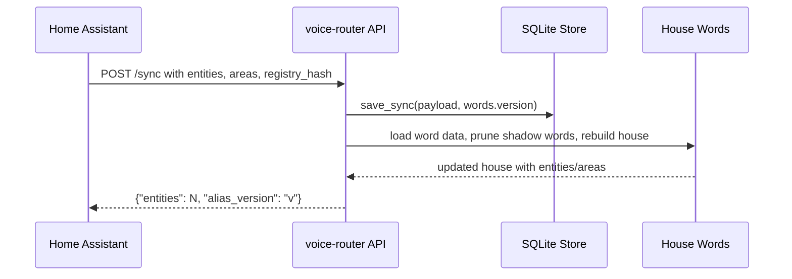
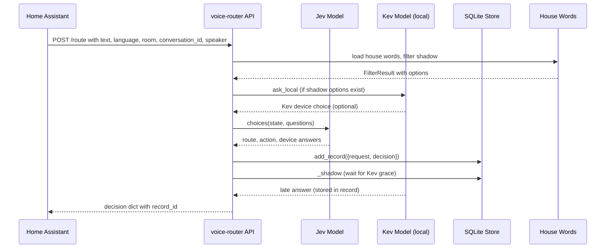
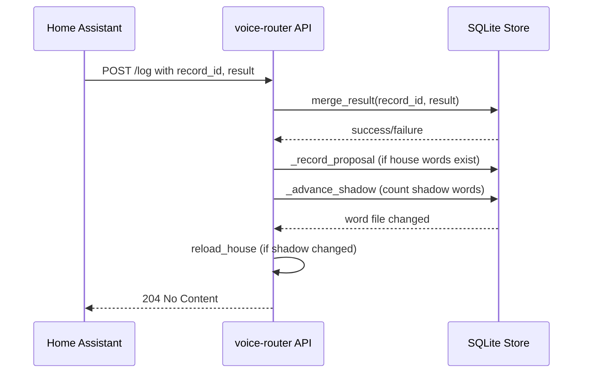
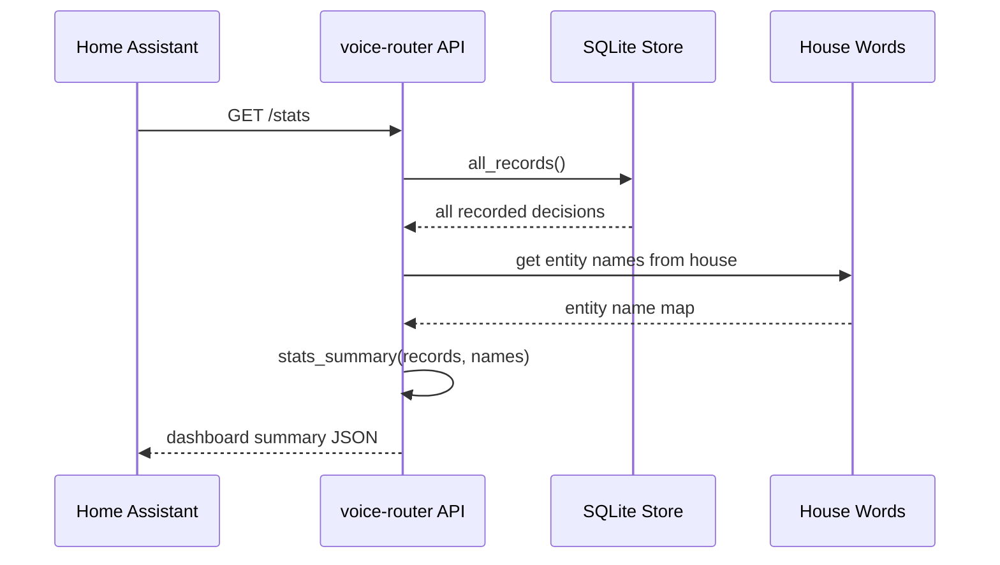
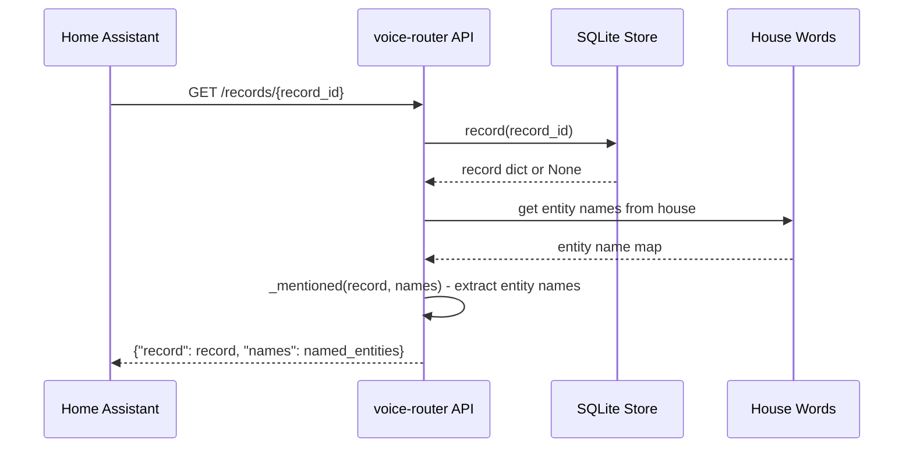
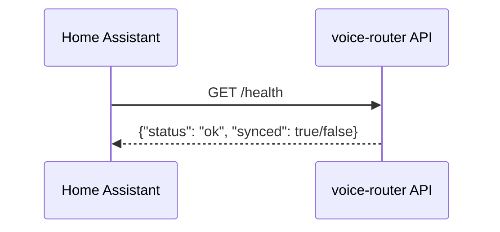
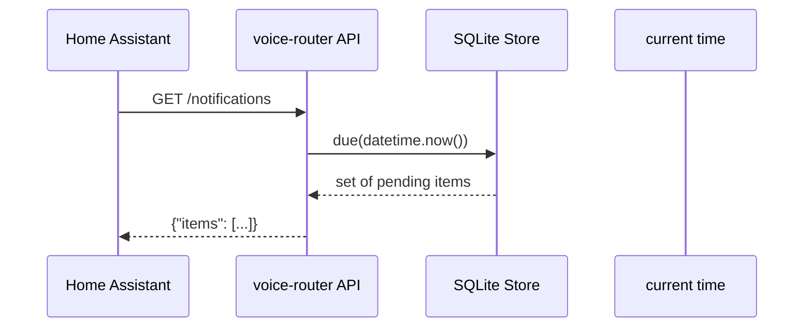
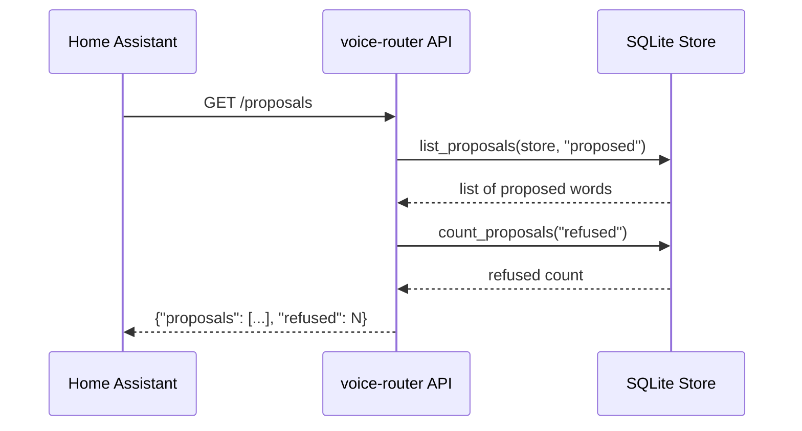
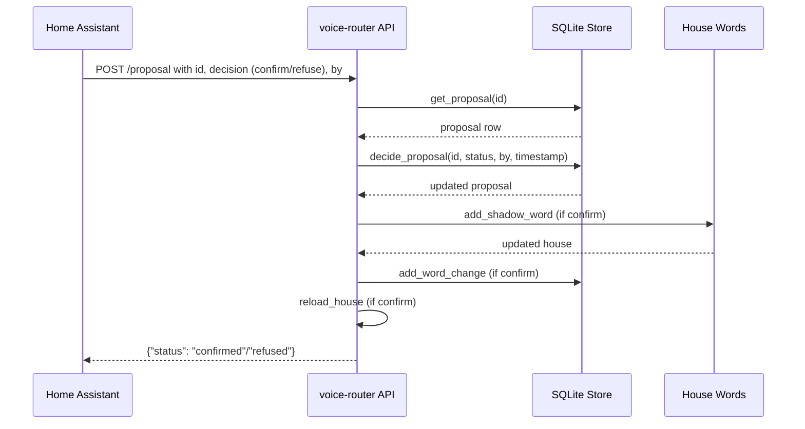

# voice-router API Diagrams

This document contains sequence and flow diagrams for each voice-router API endpoint, showing the command, its results, and the path taken through the system.

## Table of Contents

1. [Sync House](#1-sync-house)
2. [Route Command](#2-route-command)
3. [Log Action Result](#3-log-action-result)
4. [Get Stats](#4-get-stats)
5. [Get Record](#5-get-record)
6. [Health Check](#6-health-check)
7. [Notifications](#7-notifications)
8. [Proposals](#8-proposals)
9. [Decide Proposal](#9-decide-proposal)

---

## 1. Sync House

### HTTP: `POST /sync`

**Path taken:**
1. Receive sync body with entities, areas, registry_hash
2. Load previous house words
3. Prune shadow words for entities no longer in the registry
4. Rebuild the House from the new sync payload
5. Save the sync payload and words version to SQLite store
6. Return entity count and alias version

**Result:** `{"entities": <count>, "alias_version": "<version>"}`

---

## 2. Route Command

### HTTP: `POST /route`

**Path taken:**
1. Receive the spoken command text and satellite context
2. Filter the house words to get shadow options (confirmed words)
3. If shadow options exist, ask Kev locally for device decision
4. Ask Jev (OpenRouter) for route, action, and device in one request
5. Store the full decision as a record in SQLite
6. Wait grace period (0.05s) for Kev answer
7. If Kev answer arrives within grace, merge it into the decision
8. Return the full decision to Home Assistant

**Result:** Full decision dictionary including:
- `route`: the route name (e.g., "device_command")
- `act`: whether the command acts
- `action`: the action to perform
- `entity_ids`: chosen device entity IDs
- `record_id`: unique record identifier
- `local`: Kev answer when available
- `alias_version`, `registry_hash`

---

## 3. Log Action Result

### HTTP: `POST /log`

**Path taken:**
1. Receive record_id and action result
2. Merge the result into the record (keeps status, doesn't replace)
3. If house words exist, record any missed word as a proposal
4. Count shadow words to track Kev/Jev agreement
5. If shadow word count reaches 20, reload house words
6. Return 204 No Content (no body)

**Result:** `204 No Content` (success) or `404` (unknown record)

---

## 4. Get Stats

### HTTP: `GET /stats`

**Path taken:**
1. Retrieve all records from the SQLite store
2. Get entity names from the current house words
3. Generate a dashboard summary using `stats_summary()`
4. Map entity IDs to human-readable names
5. Return the summary

**Result:** Dashboard summary containing:
- Total records count
- Device choices distribution
- Action distribution
- Agreement stats between Kev and Jev
- Shadow word statistics

---

## 5. Get Record

### HTTP: `GET /records/{record_id}`

**Path taken:**
1. Look up the record by record_id in SQLite
2. If not found, return 404
3. Get entity names from the current house words
4. Extract mentioned entity names from the record's decision
5. Return the full record and the named entities

**Result:** `{"record": {full decision}, "names": {"entity_id": "entity name", ...}}`

---

## 6. Health Check

### HTTP: `GET /health`

**Path taken:**
1. Check if a sync exists (house is loaded)
2. Return status and sync state

**Result:** `{"status": "ok", "synced": true/false}`

*Note: No authentication token required.*

---

## 7. Notifications

### HTTP: `GET /notifications`

**Path taken:**
1. Get the current time
2. Query the store for due notifications
3. Return the complete set of items waiting

**Result:** `{"items": [notification1, notification2, ...]}`

---

## 8. Proposals

### HTTP: `GET /proposals`

**Path taken:**
1. List all proposals with status "proposed"
2. Count how many proposals were refused
3. Return both counts

**Result:** `{"proposals": [{"id": "...", "entity_id": "...", "word": "..."}, ...], "refused": 5}`

---

### POST /proposal - Confirm/Refuse a Proposal

**Path taken:**
1. Look up the proposal by ID
2. Validate the proposal is still in "proposed" status
3. Mark the proposal as "confirmed" or "refused"
4. If confirming: add the word as a shadow word for the entity
5. If confirming: record the word change
6. If confirming: reload house words under the decision lock
7. Return confirmation status

**Result:** `{"status": "confirmed"}` or `{"status": "refused"}`

---

## 9. Summary

| Endpoint | Purpose | Key Result |
| --- | --- | --- |
| `POST /sync` | Sync house words | `{"entities": N, "alias_version": "v"}` |
| `POST /route` | Decide a command | Full decision + `record_id` |
| `POST /log` | Log action result | `204 No Content` |
| `GET /stats` | Dashboard summary | Aggregated stats |
| `GET /records/{id}` | Get one record | Record + named entities |
| `GET /health` | Health check | `{"status": "ok", "synced": ...}` |
| `GET /notifications` | Pending notifications | `{"items": [...]}` |
| `GET /proposals` | Pending proposals | `{"proposals": [...], "refused": N}` |
| `POST /proposal` | Confirm/refuse proposal | `{"status": "confirmed"|"refused"}` |

---

*Generated for the voice-router project. All endpoints require bearer token authentication except `GET /health`.*